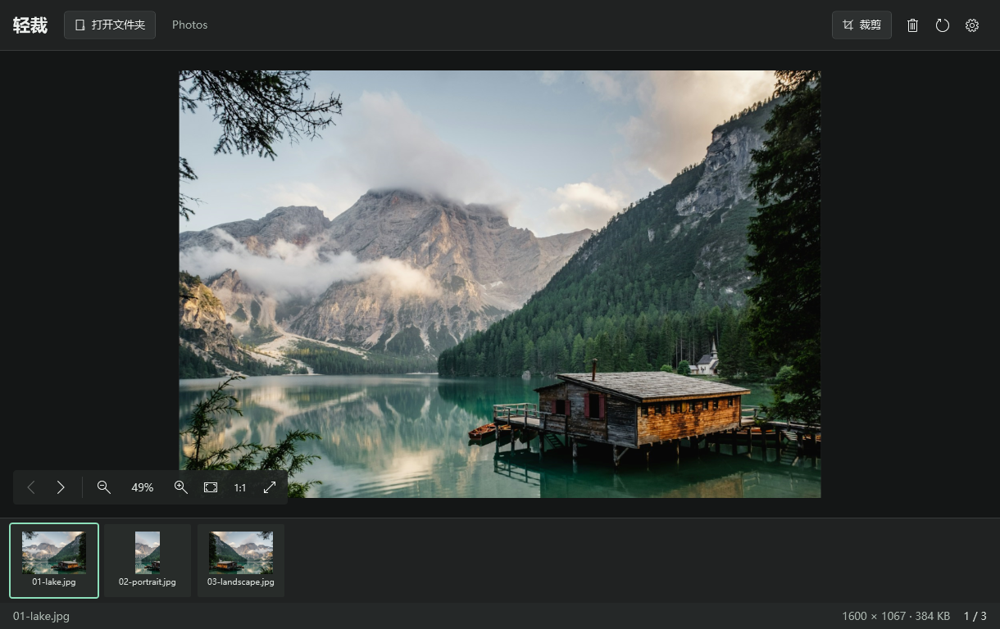
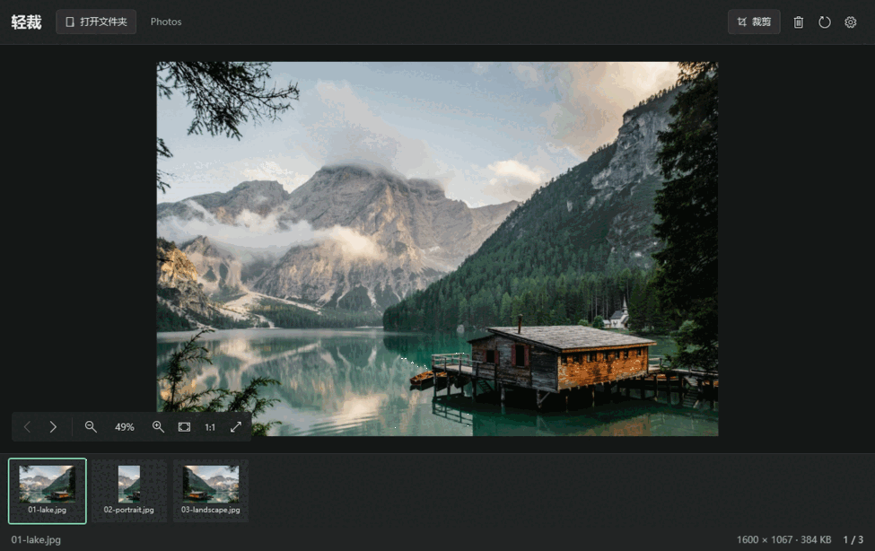

# QuickCrop · 轻裁

Windows 本地图片查看与连续裁剪工具。打开文件夹，用方向键浏览，选择尺寸后裁剪、预览、保存并自动处理下一张。图片处理在本机完成，不上传照片。

当前版本：**1.3.1** · Windows 10/11 x64 · .NET 10 / WPF



## 下载运行

前往 [最新发布页](https://github.com/Omnivored/QuickCrop/releases/latest)，下载压缩包，解压后运行 `QuickCrop.exe`。

| 版本 | 适合情况 | 下载 |
| --- | --- | --- |
| Portable | 推荐。自带运行环境，不需要安装 .NET | [免安装运行环境版](https://github.com/Omnivored/QuickCrop/releases/download/v1.3.1/QuickCrop-1.3.1-Portable.zip) |
| Light | 已安装 .NET 10 Desktop Runtime x64，程序包更小 | [轻量版](https://github.com/Omnivored/QuickCrop/releases/download/v1.3.1/QuickCrop-1.3.1-Light.zip) |

轻量版需要的是 [.NET Desktop Runtime 10 x64](https://dotnet.microsoft.com/download/dotnet/10.0)。程序尚未商业签名，Windows 可能提示未知发布者；发布页附 SHA-256 校验文件。

## 主要功能

| 功能 | 实际行为 |
| --- | --- |
| 文件夹看图 | 左右键切图、底部缩略图、拖入文件夹或图片、可选包含子文件夹 |
| 大图浏览 | 按视口准备预览，后台预读相邻图片，放大时按需补载高清细节 |
| 六格尺寸区 | 三列两行，前五格可自定义，第六格下拉显示其他尺寸和裁剪方式 |
| 自定义模板 | 自定义名称、宽高比例或精确输出像素；默认 `9:16`、`2:3`、`1:1`、`16:9`、`3:2` |
| 最大选框 | 点击尺寸后，选框按比例直接铺满原图可容纳的最大范围 |
| 固定尺寸批次 | 勾选后，后续图片沿用当前比例或像素输出尺寸，重启后仍记住 |
| 裁剪预览 | 调整选框后松开鼠标，立即放大预览；返回编辑或撤销上一次选区调整 |
| 缩放与平移 | 浏览、裁剪、预览均可滚轮缩放；中键拖动平移 |
| 连续保存 | `Ctrl+S` 生成成品、归档原图、自动进入下一张未处理图片，无文件选择弹窗 |
| 成品替换列表 | 成品和新缩略图保留在原图的位置，已处理图片仍可查看 |
| 旋转记忆 | `Ctrl+←` / `Ctrl+→` 旋转 90°，浏览方向逐图记忆，不直接覆盖原图 |
| 回收站删除 | `Delete` 直接移入回收站，不弹确认；无法回收时不降级为永久删除 |

## 动图演示

真实程序界面的分步状态回放，展示选尺寸、调整、放大预览、回退和保存后的列表替换。动图不是实时录屏，图中目录已替换成示例目录。



[完整图文与动图演示](docs/DEMO.md) · [详细使用指南](docs/USER_GUIDE.md) · [更新记录](CHANGELOG.md)

## 第一次使用

1. 打开图片文件夹。
2. 需要修改保存位置时，在设置中预设成品目录、原图归档目录和格式。默认成品保存在原图所在目录，原图归档至其中的“原图归档”子目录。
3. 点击裁剪或按 `F2`，直接进入裁剪，没有目录确认步骤。
4. 选择尺寸并调整选框。松开鼠标后自动放大预览；`Esc` 返回继续调整，`Ctrl+Z` 撤销上一次选区调整。
5. 批量裁成同一规格时，勾选“固定裁剪尺寸”。
6. 按 `Ctrl+S` 保存并继续下一张。成品替代列表中的原图，原图文件进入归档目录。

“比例”模板只限制形状；“像素”模板会把所选区域缩放到精确像素尺寸，小选区也可能被放大。预览不修改原文件，保存才会导出和归档。首次使用建议先用少量副本验证目录配置。

## 常用操作

| 按键或鼠标 | 操作 |
| --- | --- |
| `←` / `→` | 浏览上一张 / 下一张；裁剪编辑中移动选区 |
| `Ctrl+←` / `Ctrl+→` | 左转 / 右转 90° |
| `Delete` | 直接移入回收站，无确认弹窗 |
| `F2` / `Ctrl+Space` | 进入裁剪；后者可在设置中改键 |
| `Ctrl+S` / 裁剪时 `Enter` | 保存、归档原图并继续下一张 |
| `Esc` | 预览中返回调整；编辑中取消裁剪 |
| `Ctrl+Z` | 撤销上一次选区调整 |
| 滚轮 / `+` / `-` | 缩放 |
| 按住鼠标中键拖动 | 平移图片 |
| `F` / `1` / `F11` | 适应窗口 / 实际像素 / 全屏 |

`Ctrl+Space` 可能被中文输入法占用，直接用 `F2` 或在设置中更换组合键即可。完整按键、保存规则和限制见 [使用指南](docs/USER_GUIDE.md)。

## 支持格式

读取：JPEG/JFIF、PNG、BMP/DIB、GIF、TIFF、WebP、HEIC/HEIF、AVIF、ICO、TGA、PSD、PPM/PGM/PBM、PCX。HEIC 等格式使用内置解码库，不要求额外购买商店扩展。

导出：PNG、JPEG、WebP、TIFF、BMP；圆形裁剪自动使用带透明背景的 PNG。动图、多页文件只处理首帧或首页；不支持相机 RAW、SVG/PDF、PSD 图层编辑及高位深/HDR 母版流程。单张最多 2 亿像素。

## 构建与测试

Windows x64 与 .NET 10 SDK：

```powershell
dotnet run --project QuickCrop.csproj
dotnet run --project tests -c Release -p:BaseOutputPath=bin/verify/ -- --ui --recycle
.\build.ps1
.\build.ps1 -Standalone
```

1.3.1 发布前验证：**117 项通过，0 项失败**。测试只操作独立生成的临时图片和设置。回收站测试会把临时测试图放入系统回收站，不会操作用户原图。

[构建、测试与演示生成](docs/TESTING.md) · [第三方素材与许可说明](docs/MEDIA.md)

## 数据与许可

设置保存在 `%LOCALAPPDATA%\QuickCrop\settings.json`，浏览旋转记录保存在同目录的 `view-rotations.json`，照片不会上传到网络。仓库不包含个人照片、用户设置或本地临时输出。

项目自身尚未指定开源许可证。第三方组件的许可及声明位于 [LICENSES](LICENSES/)，演示照片和测试素材来源见 [素材说明](docs/MEDIA.md)。
