# QuickCrop 功能演示

适用版本：1.3.1。返回 [首页](../README.md)，查看 [完整使用指南](USER_GUIDE.md)。

以下图片由实际 WPF 界面生成，使用公开样例照片，不包含用户照片或本地设置。动图是程序界面的分步状态回放，不是实时录屏，也不用于证明响应耗时；临时目录在截图中已替换为 `D:\Photos\Cropped` 和 `D:\Photos\Originals` 等中性示例路径。

## 1. 文件夹浏览与旋转记忆

打开文件夹后，主区显示当前图片，底部列出缩略图。左右键浏览，点击缩略图可跳到对应图片。也可以直接拖入图片或文件夹。

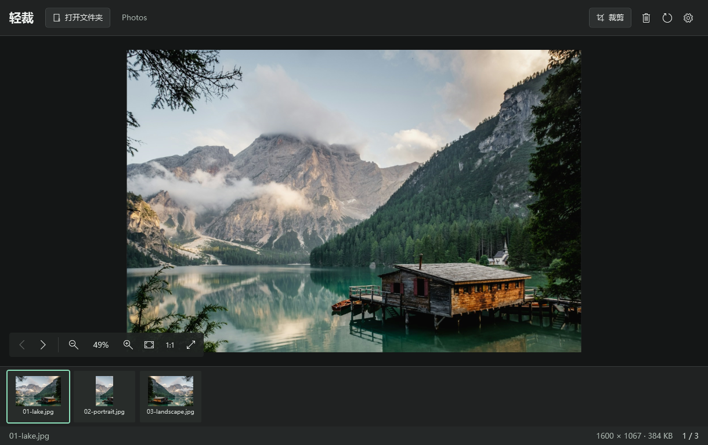

按 `Ctrl+→` 将第一张旋转 90°，切到下一张，再切回来，第一张仍保持旋转后的方向。每张图片独立记录，刷新、重开文件夹、重启后可以恢复；浏览旋转不覆盖照片本身。

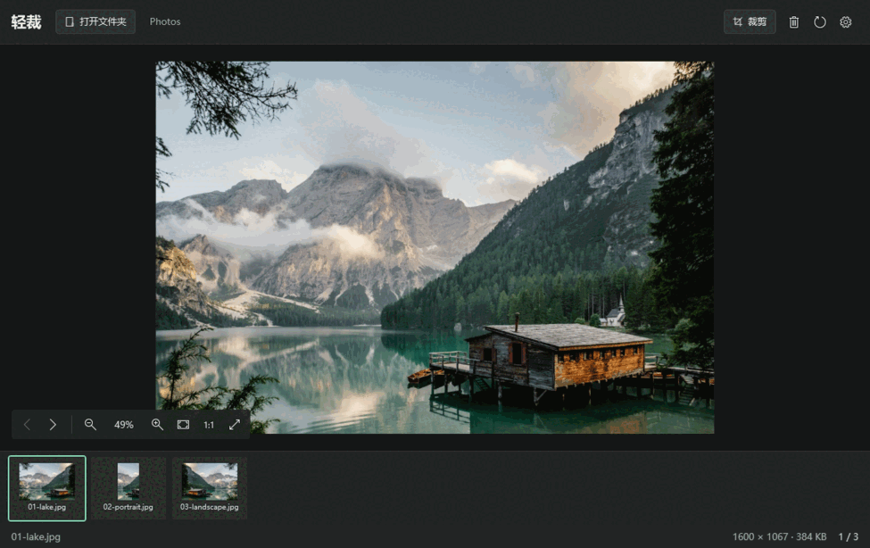

保存裁剪时，旋转会真正写入成品，未经改动的原文件进入归档目录。之后查看成品不会再次叠加浏览方向。

## 2. 点击尺寸直接铺满

点击顶部裁剪按钮或按 `F2`，直接进入编辑，没有目录确认窗口。

右侧尺寸区是三列两行：默认前五格为 `9:16`、`2:3`、`1:1`、`16:9`、`3:2`；第六格“更多”包含其余模板、自由裁剪、原图比例、自定义比例、固定选区像素和圆形裁剪。

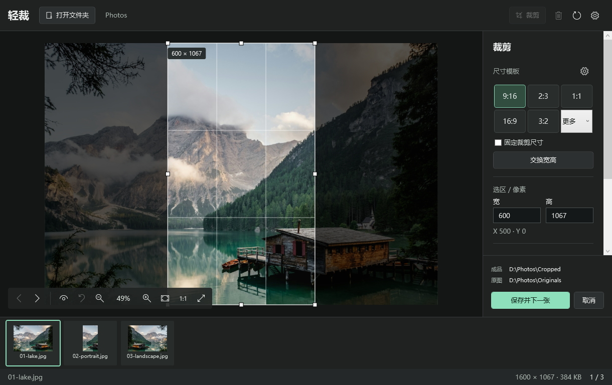

选择比例后，选框居中扩展到原图内可容纳的最大矩形。竖向比例通常贴满图像高度，横向比例可能贴满宽度；不会为了铺满而拉伸原图，也不会留下默认 15% 的额外边距。

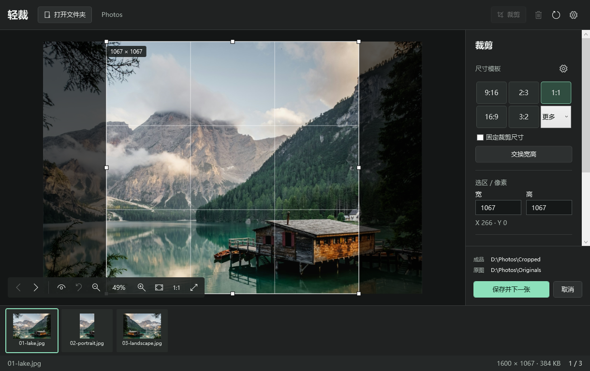

之后可以拖动选框、八个控制点，或输入选区宽高调整细节。

## 3. 裁剪时滚轮缩放

鼠标放在想检查的细节处滚动，图片围绕该位置缩放，裁剪框对应的原图像素范围不会因为缩放而改变。按住鼠标中键拖动可平移图片，查看边缘。

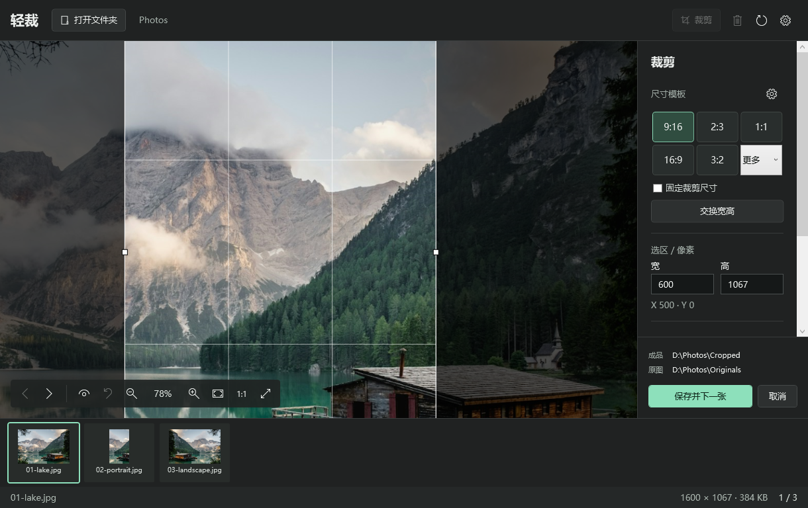

底部仍可使用放大、缩小、适应窗口和实际像素按钮；`F` 恢复适应，`1` 查看实际像素。高清细节按需加载，保留旋转、翻转和选区。

## 4. 松手自动预览、返回与撤销

调整完选框后松开鼠标，程序立即放大显示所选区域，隐藏遮罩、选框与网格。预览中依然可以缩放，左键或中键拖动图片查看细节。


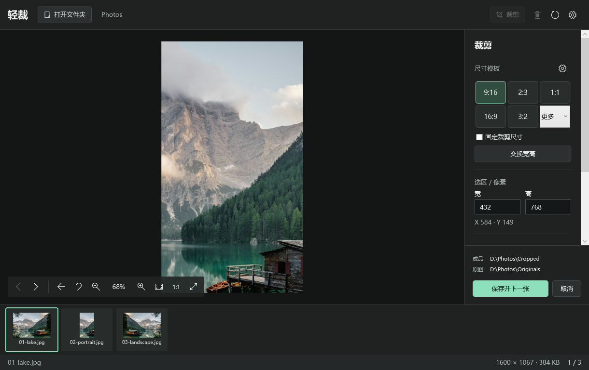

返回与撤销是不同操作：

| 你想做的事 | 操作 | 发生什么 |
| --- | --- | --- |
| 继续微调刚才的裁剪 | 返回箭头或 `Esc` | 回到刚才的选区，恢复原编辑缩放与平移 |
| 不要刚才那次选区调整 | 撤销箭头或 `Ctrl+Z` | 恢复前一次选区，最多保留当前模式下 64 次 |
| 随时看一眼成品效果 | 眼睛图标 | 不必重新拖动即可进入预览 |
| 放弃整次未保存裁剪 | 编辑状态下 `Esc`，或取消 | 返回浏览，不写入文件、不归档 |
| 确认并保存 | `Ctrl+S` 或保存按钮 | 导出成品、移动原图并继续下一张 |

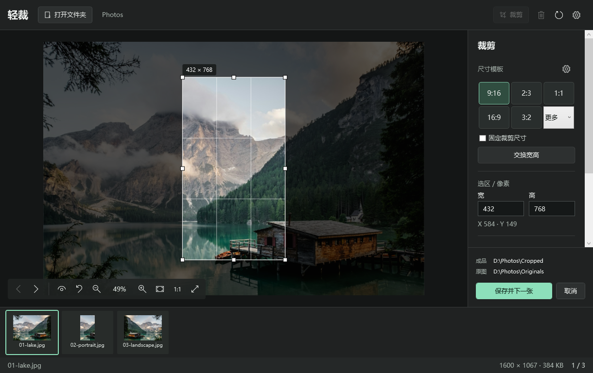


撤销不是已保存文件的恢复按钮。切换图片、模式或重置选区后，不保留旧选区历史。

## 5. 创建命名模板

点击尺寸区旁的齿轮，在模板管理窗口点击加号。表格可以编辑名称、类型、宽和高，下方五个下拉框决定前台五个按钮的内容。

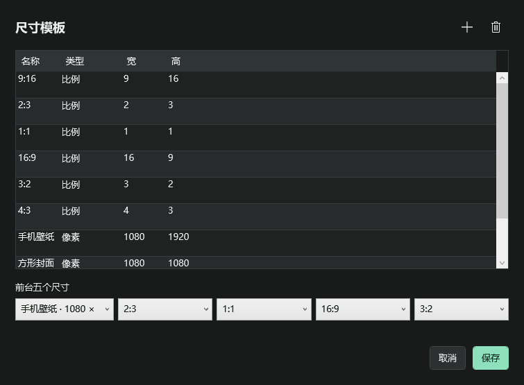

例如建立“手机壁纸”：

| 字段 | 填写内容 |
| --- | --- |
| 名称 | 手机壁纸 |
| 类型 | 像素 |
| 宽 | 1080 |
| 高 | 1920 |
| 前台位置 | 可放到任意一个前台位置；不设置则放在“更多”中 |

选择已经被其他位置使用的模板时，两者互换，不出现重复位置。名称最多 40 个字符，模板名称不能重复，至少保留五个模板。

“比例”与“像素”的差别：前者只限制形状，后者会把所选区域缩放到指定的输出分辨率。选区不足 1080 × 1920 时也会被放大，不能凭空增加真实细节。

## 6. 固定尺寸连续处理

选好模板后勾选“固定裁剪尺寸”，记住的是勾选那一刻的比例以及像素输出尺寸，不是选框的位置。后续横图和竖图都自动使用同一套规格，可以继续移动或缩小选框。

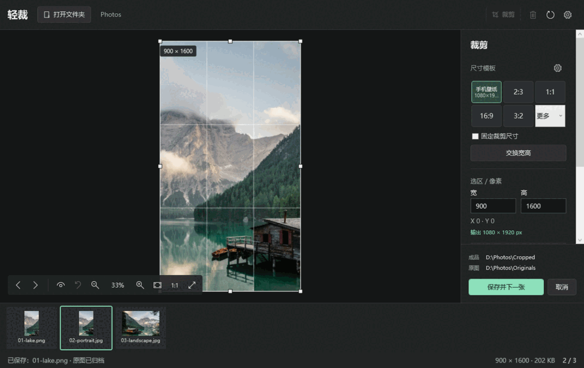

固定期间尺寸按钮及宽高交换停用。要换一套规格，先取消勾选，再选择新模板，按需重新勾选。固定状态和模板配置都会保存，重启后仍生效。

## 7. 保存、归档与原位替换

保存的完整顺序是：

```text
导出当前选区
    → 将未经修改的原文件移到归档目录
    → 将成品和新缩略图放到原图的列表位置
    → 自动选择下一张未处理图片并进入裁剪
```

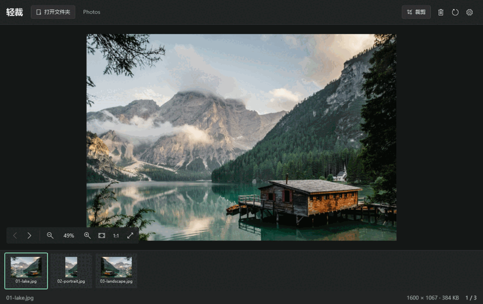

下面第一张原为 `01-lake.jpg`，保存后同一位置变成 `01-lake.png`，竖向缩略图已经反映裁剪结果；程序自动进入第二张，列表总数不减少。

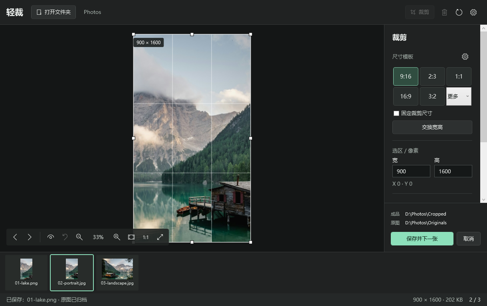

成品仍可点回查看，自动连续处理会跳过本轮已完成的图片。全部完成后停在最后保存的成品。刷新保留本轮成品的位置，即使成品保存到原文件夹之外；重新打开文件夹则开始新一轮扫描。

默认成品保存在原图目录，原图进入其中的“原图归档”子目录。输出与原图同目录且格式相同时，成品沿用原文件名，未修改的原文件仍保存在归档目录。其他同名冲突自动编号，不覆盖其他文件。

## 8. 预设目录与快捷键

目录和格式只在设置中修改。进入裁剪和保存时不再弹出文件选择窗口。

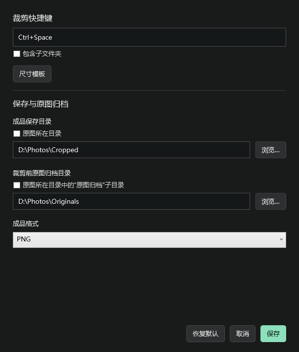

可以选择默认使用每张原图的目录，或指定统一的成品与归档目录；两者不能配置成危险的重叠关系。输出支持沿用可写原格式以及 PNG、JPEG、WebP、TIFF、BMP。圆形裁剪自动输出透明 PNG。

默认裁剪快捷键为 `Ctrl+Space`，可点击设置中的快捷键输入框后按下新组合键。中文输入法可能占用这个组合；固定入口 `F2` 一直可用。

## 9. 小窗口与删除

小窗口中尺寸区仍保持三列两行，侧栏内容可滚动，保存与取消按钮固定在底部。

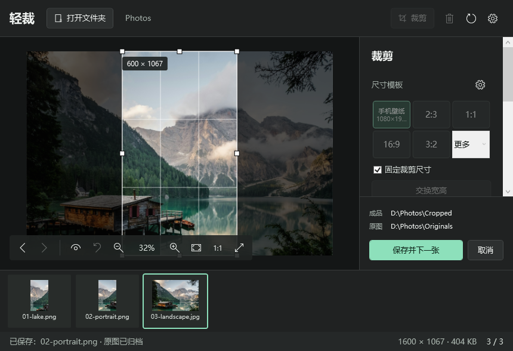

浏览时按 `Delete` 直接移入 Windows 回收站，不弹出确认。长按不会连删，无法回收时保留原文件，不自动改成永久删除。误删可去 Windows 回收站还原；保存时的原图归档不是回收站删除。

完整限制、格式列表、数据目录和按键表见 [使用指南](USER_GUIDE.md)。
